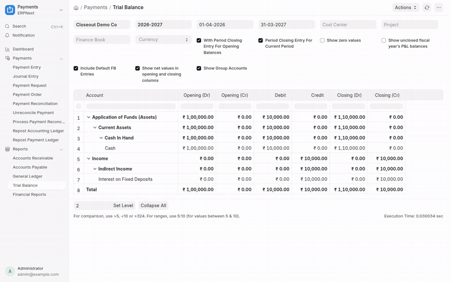

# Closeout

Year-end close helper for ERPNext on Frappe v16. It reads your ledger and posts nothing.

Before you post a Period Closing Voucher, **Close Readiness** shows in one place what is still open: drafts, unreconciled items, unfinished background jobs, depreciation that was never booked and foreign currency balances still at old exchange rates.



## Close Readiness

A pass or fail checklist for one company and fiscal year. Each failing check shows a count, an amount where it applies, and a short hint on what to do.

**Ledger and documents**
- GL debits equal credits up to the year end
- No draft Sales Invoice, Purchase Invoice, Journal Entry, Payment Entry, Delivery Note, Purchase Receipt or Stock Entry
- All bank transactions reconciled
- No unallocated payments
- Earlier fiscal years have a Period Closing Voucher

**Background jobs and stock (v16)**
- No pending or failed Repost Item Valuation
- No pending or failed Repost Accounting Ledger
- No Period Closing Voucher still processing
- Stock Closing Entry is completed and up to date (only for companies with perpetual inventory)

**Depreciation**
- Depreciation due by the year end is booked. Lists schedule rows with a date up to the year end that have no journal entry, using the same rule as ERPNext's own depreciation booking. If automatic booking is off in Accounts Settings, the hint says so.

**Exchange rate revaluation**
- Foreign currency balances are revalued at the year end rate. The ledger balance of each foreign currency account is compared with the latest exchange rate on or before the year end, so a revaluation you booked by hand passes too.
- An exchange rate exists for every foreign currency in use.
- No Exchange Rate Revaluation, or its journal entries, left in Draft. ERPNext leaves the journals in Draft unless "Submit ERR Journals?" is ticked on the Company.

A check that does not apply to your company is not shown, for example the stock check without perpetual inventory.

## Closeout Trial Balance

The standard Trial Balance plus one extra row, **Unclosed prior-year P&L (virtual)**, for companies that do not post a Period Closing Voucher every year. The row carries the profit of earlier fiscal years that no voucher has closed, so the opening and closing totals balance.

ERPNext already has an option for this, "Show unclosed fiscal year's P&L balances", which keeps the old profit and loss inside the income and expense accounts. Closeout shows it as one separate line instead. If you tick that option, the report does not add the row.

- Nothing is posted and no data is changed.
- Filters: company, fiscal year, from and to date, cost center, project, finance book.

## Who can use it

Users with the Accounts User, Accounts Manager or Auditor role.

## Requirements

- Frappe v16 and ERPNext v16

## Installation

```bash
bench get-app https://github.com/s1dharthpv/closeout --branch develop
bench --site your-site install-app closeout
```

## Limitations

- The depreciation check looks at ERPNext's depreciation schedules. If you book depreciation with your own journal entries and leave the schedules alone, it reports those rows. Ignore it in that case.
- The exchange rate check uses only the Currency Exchange records on your site. It never calls an online rate service. Add a rate for the year end date if it reports a missing rate.
- Revaluation was tested on a bank account in a foreign currency. Receivable and payable accounts with party level balances, several finance books, and a base currency other than INR have not been tested.
- The virtual Trial Balance row is in the company currency. Presentation currency is not applied to it.
- The cost center, project and finance book filters are applied to the virtual row. Accounting dimensions other than cost center and project are not, so the report can be out of balance when one of those is used. Check the result against the General Ledger.
- The checklist does not cover deferred revenue and expense, or accounting dimension gaps.
- Reports do not apply per-user company permissions. Control access with roles.
- Tested on a small demo company. Try it on a copy of your data first.

## Support

See [SUPPORT.md](SUPPORT.md). Privacy details are in [PRIVACY.md](PRIVACY.md).

## Contributing

This app uses `pre-commit` for formatting and linting.

```bash
cd apps/closeout
pre-commit install
```

Tests run with `bench --site your-site run-tests --app closeout`. A `before_tests` hook creates the demo company "Closeout Demo Co" and a small ledger with two unclosed fiscal years when they are missing, so a fresh test site works. GitHub Actions runs the tests, pre-commit and the Frappe Semgrep rules on every pull request.

## License

MIT
